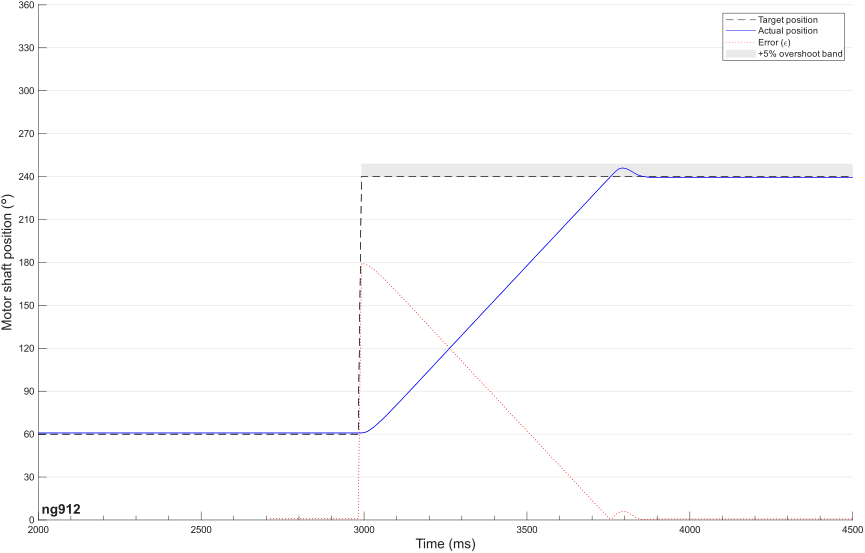

# PID Position Controller for a DC Gearmotor

Closed-loop angular position control of a 298:1 micro DC gearmotor, using an Arduino Nano ESP32, an L298N H-bridge and a Pololu magnetic encoder (0.10° resolution). Built for EE12001 Design Skills, University of Bath, 2026.

**Result (180° step):** 3.3% overshoot, within the ≤ 5% target. A steady-state error of 0.7° and settling to ±0.7° in 0.9 s missed the ±0.5° targets. The steady-state error is set by a ±1.0° dead zone (see [Analysis](#analysis)).



## Results

| Metric | Target | Measured | Met? |
|---|---|---|---|
| Overshoot | ≤ 5% of step | 3.3% (6.0°) | Yes |
| Settling time | ≤ 1 s to ±0.5° | 0.9 s to ±0.7° | No |
| Steady-state error | ≤ 0.5° | 0.7° | No |

The response settled to ±0.7° within 0.9 s but never entered the ±0.5° band. Results are from a single 180° step (see [Limitations and next steps](#limitations-and-next-steps)). The full report will be pushed after academic submission.

## System overview

Every 10 ms the Arduino Nano ESP32 takes a target position (from a potentiometer or a predefined function), reads the shaft position from the encoder and computes a PID command. The command drives the motor through the L298N, and the encoder closes the loop.

## Hardware

| Part | Details |
|---|---|
| Controller | Arduino Nano ESP32 |
| Motor driver | L298N H-bridge module |
| Motor | Micro DC gearmotor, 298:1 |
| Encoder | Pololu magnetic encoder (Item #4761) |
| Input | 10 kΩ trimmer potentiometer |


The encoder and potentiometer run from 3.3 V. The motor runs from the 5 V USB rail through the L298N. All grounds are common. The schematic (KiCad) is in [`hardware/`](hardware/schematic).

## Firmware

- **Timing:** non-blocking 10 ms loop. The measured interval, not the nominal one, is used in all calculations.
- **Position feedback:** [ESP32Encoder](https://github.com/madhephaestus/ESP32Encoder) with 4× quadrature decoding in the hardware pulse counter. 12 counts per motor revolution × 298 = 3576 counts per output revolution (0.10°).
- **Error:** wrapped to ±180° so the shaft takes the shorter path.
- **Controller:** parallel-form PID with a clamped integral term. The output is in PWM units.
- **Output conditioning:** a minimum PWM overcomes stiction, and a ±1.0° dead zone sets the output to zero near the target.
- **Direction:** the sign of the command selects which L298N input carries the PWM signal.

## Analysis

- **Steady-state error:** inside the ±1.0° dead zone the output is zero, so the shaft rests wherever it stops. The dead zone is wider than the ±0.5° target, so it sets the error floor. TODO: state why the dead zone was set at ±1.0°.
- **Overshoot (hypothesis):** integral windup is the likely main cause, as the output is saturated for most of the step. Proportional action (K<sub>p</sub>·e) alone saturates the output until the error falls to 3.4°. With the accumulated integral term, the output desaturates only within 1.3° of the target, too late to brake the motor before the target is crossed. This is inferred from the trace and has not been measured.
- **Slew rate:** the maximum rate (about 240°/s, output saturated) is set by the motor supply, not by the gains.
- **Wrap boundary:** a 180° step lies on the error-wrapping boundary, so the direction of rotation depends on where the shaft rested before the step.

## Limitations and next steps

- **Windup is unverified.** Next: log the integral term during a step, then compare against back-calculation anti-windup.
- **The dead zone exceeds the steady-state spec.** Next: reduce it and measure the effect on limit cycling.
- **Results come from a single run at the wrap boundary.** Next: repeat at several step sizes away from ±180° and report the mean and spread.

## Reflections

Tuning by trial and error got the hardware, firmware and measurements working end to end, and showed me directly what each parameter did. It also showed the limits of the approach: I could not explain the overshoot or the dead-zone trade-off from the data alone. I plan to return to this project after studying system identification and anti-windup methods, starting from a plant model and a logged integral term so that each change can be predicted before it is tested.

## Repository contents

```
firmware/   Arduino sketch
matlab/     Analysis and plotting script
hardware/   Schematic and images
data/       Recorded step responses
docs/       Figures
```

## Tools

Arduino IDE (C++), MATLAB, KiCad, Git/GitHub.
